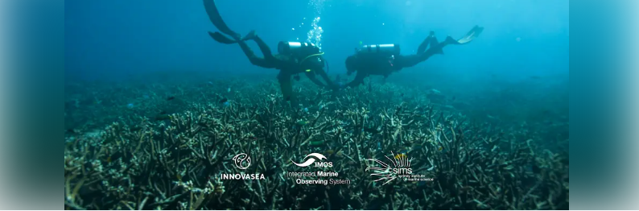
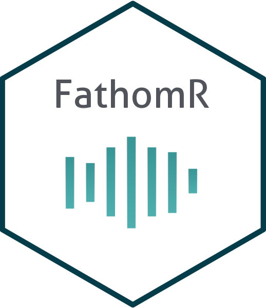
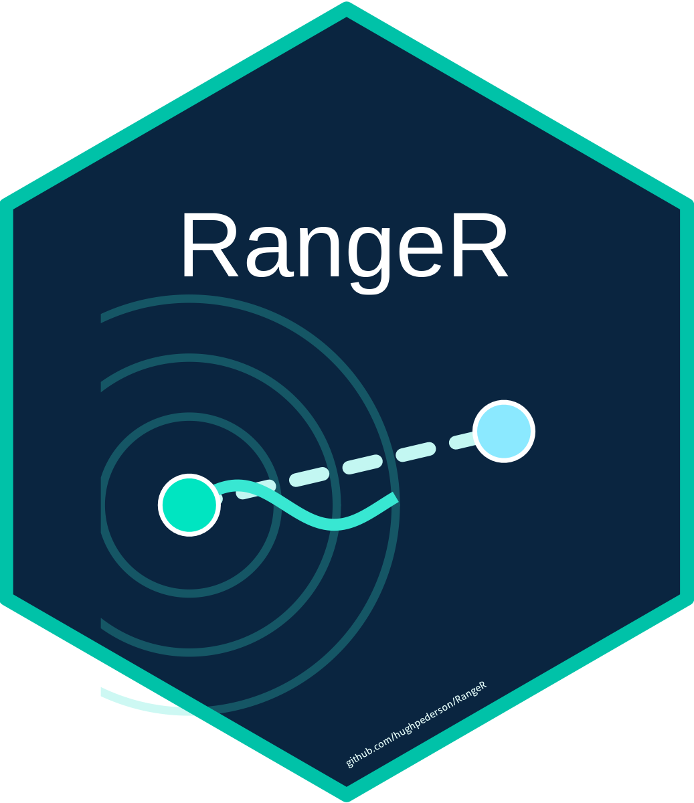
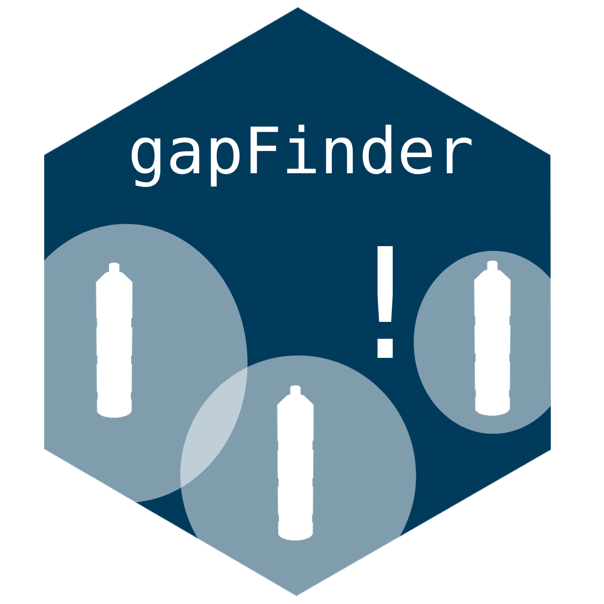

# Innovasea - IMOS Animal Tracking Faility Acoustic Telemetry Workshop 2026
Welcome to the 2026 acoustic telemetry workshop, proudly presented by the teams at Innovasea and the IMOS Animal Tracking Facility. The workshop brings together marine and freshwater researchers to learn and share their experience using acoustic telemetry systems to monitor the movement of aquatic species.

The workshop is designed for knowledge sharing and covers a wide range of material. We expect there will be useful information for researchers new to the field and those with experience using the equipment. To facilitate the workshop, we have prepared the supporting materials contain within this repository and encourage you to download it to your local hard drive prior to the workshop. The repo contains code examples and sample data supporting the interactive and walkthrough coding sessions. Please take a moment to read through the workshop preparation information below to ensure you have all software and packages installed prior to arriving.  

## Workshop Venue and Agenda

### Venue
The 2026 Innovasea / IMOS Animal Tracking Facility Workshop will be held at the RACV Hobart Hotel - 154-156 Collins Street Hobart, TAS. The hotel is located in the centre of Hobart and a short walk from the waterfront an CBD hotels. 

### Agenda
- 8:30	- Doors open to Trackers 	
- 9:00	- Workshop Opening 	
     Welcome and Housekeeping	
- 9:15	Morning Session	
    - Introduction to Acoustic Telemetry	
    - Equipment configuration
     - Downloading data from receivers
    - Assessing data and receiver diagnostics in Fathom Connect
    - IMOS database - 101
- 10:30	Break	
     - Tea, coffee and finger food  	
- 11:00	Telemetry Speed Talks	
- 12:00	Lunch break	
     Lunch provided for Trackers	
- 1:00	Analysis Session 1	
    - Interactive Coding - Range Testing - FathomR & RangeR packages
    - Receiver performance and diagnostics - gapFinder package walkthrough
- 2:30	Break	
- 3:00	Analysis Session 2	
    - Interactive Coding - Quality control and visualising raw detection data
    - Residency analysis	
    - Home range analysis - handling autocorrelation 
- 4:30	Closing remarks	

## Workshop Preparation

The afternoon sessions consist of interactive coding sessions and guided walkthroughs of new R packages. Prior to the start of the workshop we encourage you to install or update to the latest versions of:

-  RStudio (https://posit.co/downloads)
-  R (https://www.r-project.org/)

We also encourage you to install the following R packages from CRAN:

install.packages(c("patchwork", "dplyr", "tidyr", "suncalc", "remotes",
  "tidyverse", "classInt", "data.table", "leaflet", "ctmm", "sp", "sf", "htmlwidgets))

 

And from GitHub:

  
  &nbsp;&nbsp;
  
   &nbsp;&nbsp;
   
    &nbsp;&nbsp;
   

- **FathomR**
  
remotes::install_github("Fish-Tracking-Data-Team/FathomR",
  build_vignettes = TRUE,
  dependencies = TRUE)

- **RangeR**

remotes::install_github("Fish-Tracking-Data-Team/RangeR",
                        build_vignettes = TRUE,
                        dependencies = TRUE)

- **gapFinder**

remotes::install_github("IMOS-AnimalTracking/gapFinder",
  build_opts = c("--no-resave-data", "--no-manual"),
  build_vignettes = TRUE)

- **remora**

remotes::install_github("IMOS-AnimalTracking/remora",
  build_vignettes = TRUE,
  dependencies = TRUE)

